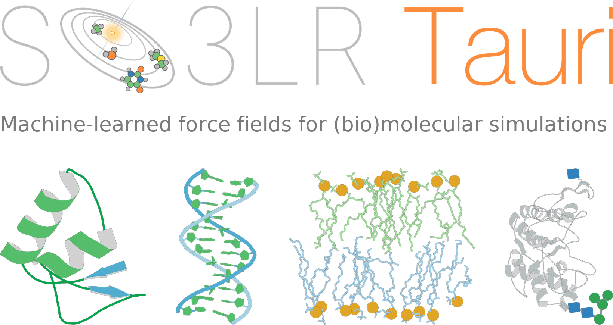

[](https://so3lr.github.io/)
[](https://colab.research.google.com/github/general-molecular-simulations/so3lr/blob/main/examples/so3lr_colab_example.ipynb)
[](#citation)
[](https://doi.org/10.48550/arXiv.2611.06237)
[](https://doi.org/10.1021/jacs.5c09558)
[](https://doi.org/10.5281/zenodo.22920714)

<p align="center"></p>

## About

SO3LR - pronounced *Solar* - is a pretrained machine-learned force field for
(bio)molecular simulations. It integrates the fast and stable SO3krates neural
network for semi-local interactions with universal pairwise force fields designed
for short-range repulsion, long-range electrostatics, and dispersion interactions.

## Installation

Try SO3LR without any local installation using our
[Colab notebook](https://colab.research.google.com/github/general-molecular-simulations/so3lr/blob/main/examples/so3lr_colab_example.ipynb).

We recommend installing SO3LR with [uv](https://docs.astral.sh/uv/) (it's magical):

```shell
git clone https://github.com/general-molecular-simulations/so3lr.git
cd so3lr
uv sync --locked --extra cuda12   # GPU; drop --extra cuda12 for CPU
source .venv/bin/activate
so3lr --help
```

If JAX is already installed on your cluster (CUDA or ROCm), install SO3LR
into that environment:

```shell
git clone https://github.com/general-molecular-simulations/so3lr.git
cd so3lr
uv pip install .   # or: pip install .
so3lr --help
```

See the [installation guide](https://so3lr.github.io/installation/) for optional extras.
More details about JAX installation can be found [here](https://docs.jax.dev/en/latest/installation.html).

## Quick start

SO3LR provides a command-line interface for geometry optimization, molecular
dynamics and evaluation. Each command can be run with `--help` to see all
available options.

```shell
# Geometry optimization
so3lr opt --input geometry.xyz --force-conv 0.05

# NVT and NPT molecular dynamics
so3lr nvt --input geometry.xyz --temperature 300 --dt 0.5 --md-cycles 100 --md-steps 100
so3lr npt --input geometry.xyz --temperature 300 --pressure 1.0 --dt 0.5 --md-cycles 100 --md-steps 100

# Evaluation on a dataset
so3lr eval --datafile dataset.extxyz --lr-cutoff 100 --save-to predictions.extxyz
```

For longer simulations, use a settings file, `so3lr --settings settings.yaml`
(see [molecular dynamics](https://so3lr.github.io/usage/md/)).

To use SO3LR as an ASE calculator:

```python
from ase.io import read
from so3lr import So3lrCalculator

atoms = read("geometry.xyz")
atoms.info["charge"] = 0          # total charge; 0 if unset
atoms.calc = So3lrCalculator(model="so3lr-tauri-m", lr_cutoff=100)

energy = atoms.get_potential_energy()
forces = atoms.get_forces()
```

Units are eV and Å. The default long-range cutoff of 12 Å is meant for periodic,
condensed-phase systems; for gas-phase simulations, we suggest using
`--lr-cutoff 100`.

## Models

The models are bundled with the package and selected by name. The SO3LR Tauri
models cover H to At (Z = 1–85) and are described in the
[SO3LR Tauri preprint](https://doi.org/10.48550/arXiv.2611.06237).

- `so3lr-tauri-m` (default): start here; the model we use for biomolecular MD.
- `so3lr-tauri-l`: the most accurate, recommended for reactions; 3.7× slower
  than `-m`.
- `so3lr-tauri-s`: 1.4× faster than `-m`.
- `so3lr`: the original model from the
  [JACS paper](https://doi.org/10.1021/jacs.5c09558), for H, C, N, O, F, P, S and
  Cl, kept to reproduce published results.

Use the same name on the command line (`--model`) and in settings files
(`model:`), or pass a path to a fine-tuned model. To pin a release for papers
and benchmarks, add its date: `so3lr-tauri-m-2606`.

## Documentation

The full documentation is at [so3lr.github.io](https://so3lr.github.io/), including:

- [Command line](https://so3lr.github.io/usage/cli/) and [settings file](https://so3lr.github.io/usage/settings/)
- [Molecular dynamics](https://so3lr.github.io/usage/md/)
- [ASE calculator](https://so3lr.github.io/usage/ase/) and [dataset evaluation](https://so3lr.github.io/usage/evaluation/)
- [Long-range electrostatics](https://so3lr.github.io/advanced/electrostatics/) (Ewald, PME, P3M)
- [Enhanced sampling](https://so3lr.github.io/advanced/enhanced-sampling/) with PySAGES
- [Observables](https://so3lr.github.io/advanced/observables/), [gradients and Hessians](https://so3lr.github.io/advanced/derivatives/)
- [Binding energies](https://so3lr.github.io/advanced/binding-energies/)
- [Fine-tuning](https://so3lr.github.io/training/finetuning/) and [training from scratch](https://so3lr.github.io/training/from-scratch/)
- [API reference](https://so3lr.github.io/reference/api/) and [FAQ](https://so3lr.github.io/reference/faq/)

## Datasets

The quantum mechanical datasets used for training and testing SO3LR Tauri are
available on Zenodo: [10.5281/zenodo.22920714](https://doi.org/10.5281/zenodo.22920714). The data for the legacy SO3LR
model are at [10.5281/zenodo.14779793](https://doi.org/10.5281/zenodo.14779793).

## Contributing

The code and models are still evolving, and your feedback is invaluable. We would
appreciate if you [open an issue](https://github.com/general-molecular-simulations/so3lr/issues)
for any errors, inconsistencies or feature ideas. See [`DEVELOPERS.md`](./DEVELOPERS.md)
for development environments and tests.

## Citation

If you use SO3LR, please cite the papers below:

```bibtex
@article{kabylda2026so3lr,
  title = {{SO3LR Tauri: Generally Applicable Force Fields for Reactive (Bio)Molecular Simulations Covering the Periodic Table}},
  author = {Kabylda, Adil and Br{\"{u}}nig, Florian N. and Gallegos, Miguel and Frank, J. Thorben and Moerman, Evgeny and Unke, Oliver T. and Chmiela, Stefan and M{\"{u}}ller, Klaus-Robert and Tkatchenko, Alexandre},
  journal = {arXiv preprint arXiv:2611.06237},
  year = {2026},
  doi = {10.48550/arXiv.2611.06237},
  url = {https://arxiv.org/abs/2611.06237},
}

@article{kabylda2025molecular,
  title={Molecular Simulations with a Pretrained Neural Network and Universal Pairwise Force Fields},
  author={Kabylda, Adil and Frank, J Thorben and Su{\'a}rez-Dou, Sergio and Khabibrakhmanov, Almaz and Medrano Sandonas, Leonardo and Unke, Oliver T and Chmiela, Stefan and M{\"u}ller, Klaus-Robert and Tkatchenko, Alexandre},
  journal={Journal of the American Chemical Society},
  volume={147},
  number={37},
  pages={33723},
  year={2025},
  doi={10.1021/jacs.5c09558}
}

@article{frank2024euclidean,
  title={A Euclidean transformer for fast and stable machine learned force fields},
  author={Frank, Thorben and Unke, Oliver and M{\"u}ller, Klaus-Robert and Chmiela, Stefan},
  journal={Nature Communications},
  volume={15},
  number={1},
  pages={6539},
  year={2024},
  doi={10.1038/s41467-024-50620-6}
}
```

## License

The code and the legacy SO3LR model weights are released under the
[MIT License](LICENSE), and the SO3LR Tauri weights under
[CC BY-NC 4.0](licenses/LICENSE.CC-BY-NC-4.0). See [NOTICES](NOTICES.md) for
details.
