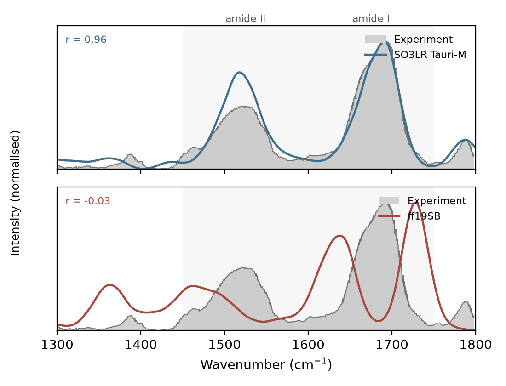

# IR spectra with MARS: SO3LR vs a classical force field

This tutorial computes the infrared spectrum of the protonated peptide
Ac-Ala<sub>5</sub>-LysH<sup>+</sup> with SO3LR Tauri and with the ff19SB force
field, and compares both with the gas-phase experiment. It uses
[MARS](https://github.com/TCPUniLU/mars), a JAX framework that runs SO3LR and
classical force fields through the same commands, so the comparison differs
only in the potential.

It follows the peptide case of the
[SO3LR vibrational spectroscopy paper](https://doi.org/10.1038/s41467-026-79241-x),
reduced to a size that runs in about half an hour on a laptop GPU.

The same workflow is available as a notebook,
[`ir_spectra_mars.ipynb`](ir_spectra_mars.ipynb), which runs every step from
this folder and plots the harmonic and MD spectra side by side.

You will:

1. compute harmonic IR spectra of one optimised structure (about a minute);
2. compute IR spectra from MD with the dipole autocorrelation function
   (the main result);
3. compare both potentials with the IRMPD spectrum of
   [Rossi et al.](https://doi.org/10.1021/jz101394u) at 300 K.

## Install

MARS needs JAX, SO3LR and, for the force field, OpenMM and ParmEd (MARS reads
the topology with them and evaluates every energy term in JAX):

```shell
conda create -n mars python=3.12 && conda activate mars
pip install -U "jax[cuda12]<0.11"          # CPU only: pip install -U "jax<0.11"
git clone https://github.com/TCPUniLU/mars.git
cd mars && pip install -e ".[mm,viewer]" && cd ..
git clone https://github.com/general-molecular-simulations/so3lr.git
cd so3lr && pip install . && cd ..
```

See the [MARS installation guide](https://github.com/TCPUniLU/mars/blob/main/docs/install.md)
for other CUDA versions.

## Input files

Download the files into one working directory:

| File | Contents |
|---|---|
| [`ala5lysh.xyz`](ala5lysh.xyz) | Starting structure (80 atoms, charge +1), atom order identical to the topology. |
| [`ala5lysh_ff19sb.prmtop`](ala5lysh_ff19sb.prmtop) | ff19SB topology for the same molecule. |
| [`rossi2010_ala5lysh_ir.csv`](rossi2010_ala5lysh_ir.csv) | Experimental IRMPD spectrum at 300 K, 1005–1798 cm<sup>-1</sup>. |
| [`plot_ir.py`](plot_ir.py) | Plotting and comparison script. |

### How the ff19SB topology was built

Ac-Ala<sub>5</sub>-LysH<sup>+</sup> ends in a neutral carboxylic acid and
carries the proton on the lysine side chain. ff19SB has no C-terminal
residue with a neutral COOH, so the topology uses a custom residue `LYC`:
the ff19SB lysine charges everywhere except the carboxyl group, which takes
the atom types and charges of the ff19SB protonated glutamate (`GLH`),
shifted uniformly so the group keeps the charge of the lysine C=O. All
bonded parameters are standard ff19SB/parm19 terms. To rebuild it with
AmberTools, download
[`build_ff19sb.leap`](build_ff19sb.leap) and
[`ala5lysh_amber_names.pdb`](ala5lysh_amber_names.pdb)
and run `tleap -f build_ff19sb.leap`.

Both potentials start from the same coordinates. The SO3LR model is pinned to
the `so3lr-tauri-m-2606` release, so the numbers below stay reproducible after
`so3lr-tauri-m` moves to a newer model (see [Models](https://so3lr.github.io/models/)).

## 1. Harmonic spectra

`mars ir` optimises the structure, computes the Hessian and the dipole
derivatives numerically, by finite differences of the forces and dipoles
(`--fd-hessian`, 0.01 Å displacements), and writes the stick spectrum:

```shell
mars ir ala5lysh.xyz --so3lr-model so3lr-tauri-m-2606 --charge 1 \
    --float64 --fd-hessian -o harm_so3lr.dat --plot --freq-range 1000 1900

mars ir ala5lysh.xyz --potential amber --prmtop ala5lysh_ff19sb.prmtop --charge 1 \
    --float64 --fd-hessian -o harm_ff19sb.dat --plot --freq-range 1000 1900
```

For SO3LR the intensities come from the charges the model predicts at each
geometry; for ff19SB from its fixed point charges. On a 4 GB laptop GPU
(NVIDIA T550) the SO3LR command takes 90 s and the ff19SB one 30 s.

A single minimum is a poor model of this experiment: at 300 K the peptide
samples helical and non-helical conformers, and the band shapes report on
that ensemble. The MD spectra below include it.

## 2. Spectra from molecular dynamics

With `--md`, MARS equilibrates with NVT, runs NVE replicas in parallel, and
takes the IR spectrum from the Fourier transform of the dipole autocorrelation
function. The dipole is built from the partial charges at every saved frame:

```shell
mars ir ala5lysh.xyz --so3lr-model so3lr-tauri-m-2606 --charge 1 \
    --md --nvt-time 2 --nve-time 20 --md-timestep 0.5 --n-replicas 8 \
    -o md_so3lr.dat

mars ir ala5lysh.xyz --potential amber --prmtop ala5lysh_ff19sb.prmtop --charge 1 \
    --md --nvt-time 2 --nve-time 20 --md-timestep 0.5 --n-replicas 8 \
    -o md_ff19sb.dat
```

Each run is 8 replicas × (2 ps NVT + 20 ps NVE) at 300 K. On the same 4 GB
laptop GPU the ff19SB run takes under 2 minutes and the SO3LR run 34 minutes.
With `--n-replicas 4` the SO3LR run takes about half as long, at the cost of a
noisier spectrum. Both runs write `md_*.dat` (wavenumber, intensity) and,
with `--plot`, a quick-look figure.

## 3. Compare with experiment

```shell
python plot_ir.py rossi2010_ala5lysh_ir.csv \
    "SO3LR Tauri-M=md_so3lr.dat" "ff19SB=md_ff19sb.dat"
```

The script scales the computed wavenumbers by 0.97 (as in the paper), smooths
them with a Gaussian (σ = 8 cm<sup>-1</sup>), normalises every spectrum in the
1300–1800 cm<sup>-1</sup> window, prints the positions of the amide I and
amide II maxima and the Pearson correlation with experiment, and writes
`ir_comparison.png`. The same script accepts the harmonic files.



| Spectrum | Amide I (cm<sup>-1</sup>) | Amide II (cm<sup>-1</sup>) | Pearson r |
|---|---|---|---|
| Experiment (IRMPD, 300 K) | 1693 | 1523 | — |
| SO3LR Tauri-M, MD | 1691 | 1518 | 0.96 |
| ff19SB, MD | 1728 | 1462 | −0.03 |
| SO3LR Tauri-M, harmonic | 1713 | 1528 | 0.42 |
| ff19SB, harmonic | 1628 | 1476 | −0.26 |

SO3LR places the amide I and amide II bands within 5 cm<sup>-1</sup> of
experiment and reproduces their widths and relative intensities, as well as
the weak C=O stretch of the carboxylic acid near 1780 cm<sup>-1</sup>.
ff19SB splits the amide I band into two peaks on either side of the
experimental maximum and shifts amide II down by about 60 cm<sup>-1</sup>;
the same result appears for ff19SB in the paper, with 100 times more
sampling, where it is traced to the conformational ensemble the force field
samples (see the paper's discussion of Ac-Ala<sub>n</sub>-LysH<sup>+</sup>). The
harmonic spectra of a single minimum, even with SO3LR, miss the band
shapes: they come from the conformational ensemble at 300 K, which only the
MD spectra sample.

## Going further

- **More sampling.** The paper averages 20 × 100 NVE runs; more replicas
  (`--n-replicas`) and longer NVE (`--nve-time`) smooth the spectrum and
  sharpen the relative intensities.
- **Conformer ensembles.** `mars ala5lysh.xyz --so3lr-model so3lr-tauri-m --charge 1`
  searches conformers, and `mars ir ensemble.xyz --all-conformers` gives a
  Boltzmann-weighted harmonic spectrum.
- **Longer helices.** Ac-Ala<sub>10</sub>-LysH<sup>+</sup> and
  Ac-Ala<sub>15</sub>-LysH<sup>+</sup> are predominantly helical, and their
  experimental spectra are in the same paper.
- **Other force fields.** MARS also reads CHARMM (`--potential charmm`), OPLS
  (`--potential opls`) and AMOEBA (`--potential amoeba`) parameters; see the
  [MARS documentation](https://github.com/TCPUniLU/mars).

## Cite

If you use this workflow, please cite SO3LR as described in
[How to cite](https://so3lr.github.io/cite/) (with the dated model, here `so3lr-tauri-m-2606`), and:

- MARS: S. Suárez-Dou, M. Gallegos, F. N. Brünig, A. Tkatchenko, "MARS:
  Machine-Learned Force Field Framework for Automated Conformational Sampling,
  Vibrational Spectroscopy, and Microsolvation", *J. Chem. Theory Comput.*
  **22**, 11125 (2026),
  [doi:10.1021/acs.jctc.6c01588](https://doi.org/10.1021/acs.jctc.6c01588);
- S. Suárez-Dou, M. Gallegos et al., "Quantum-Accurate Conformational
  Stabilities and Vibrational Dynamics in Molecules and Proteins with
  Machine-Learned Force Fields", *Nat. Commun.* (2026),
  [doi:10.1038/s41467-026-79241-x](https://doi.org/10.1038/s41467-026-79241-x);
- the experiment: M. Rossi et al., *J. Phys. Chem. Lett.* **1**, 3465 (2010),
  [doi:10.1021/jz101394u](https://doi.org/10.1021/jz101394u);
- ff19SB: C. Tian et al., *J. Chem. Theory Comput.* **16**, 528 (2020),
  [doi:10.1021/acs.jctc.9b00591](https://doi.org/10.1021/acs.jctc.9b00591).
